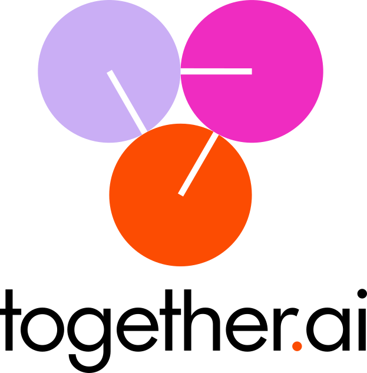
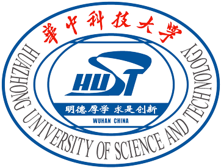

Hello! I am **Jisen Li**, an **AI Researcher at [Together AI](https://www.together.ai/)**. I recently graduated with a B.S. in Mathematics and Computer Science from the **University of Illinois Urbana-Champaign (UIUC)**. My research interests focus on **reinforcement learning (RL), inference, and AI agents**. At **Together AI**, I work on **RL algorithms and platforms** in collaboration with **[Ivan Provilkov](https://www.linkedin.com/in/ivan-provilkov/)** and **[Max Ryabinin](https://mryab.github.io/)**, and previously worked on speculative decoding and quantization with **[Dr. Shirley Wu](https://xwushirley.github.io/)** and **[Dr. Ben Athiwaratkun](https://benathi.github.io/)**.

In industry experience, I have interned at **Nexa AI**, where I worked on on-device models and AI agents; at **Snowflake**, focusing on embedding models and hybrid retrieval systems; and at **TikTok**, where I developed multimodal recommendation models.

In academic research, I have worked at **[UIUC U-Lab](https://ulab-uiuc.github.io/)** under the supervision of **[Prof. Jiaxuan You](https://jiaxuan.web.illinois.edu/)**, researching AI agent communication protocols and multi-agent benchmarking. I have also conducted research at the **University of Chicago** under the supervision of **[Dr. Eliu A. Huerta](https://scholar.google.com/citations?user=CZQuCS0AAAAJ&hl=en)**, focusing on AI deployment, and at **Tsinghua University** under the guidance of **[Prof. Yongqiang Lyu](https://www.linkedin.com/in/yongqianglu/)**, focusing on computer vision and digital signal processing.

Outside of research, I enjoy fitness and strategy games such as Go, and I'm always up for a game of billiards. Whether it's a Go board or a pool table, I love games that reward careful planning and precise execution.

## Research Interests

- **Post-Training:** Reinforcement learning (RL) algorithms, agentic RL with environment rewards, and scalable RL training platforms.
- **Inference:** Speculative decoding, KV cache quantization, and efficient model serving.
- **Agentic AI:** Agents with memory, planning, and decision-making for collaboration.

## News 🎉

- **[Oct 2026]** Contributed to the launch of **[Together Post-Training](https://www.together.ai/blog/together-post-training)** 🚀: RL and SFT with your own training loop on Together AI!
- **[Oct 2026]** Released **[ORL](https://introspective-diffusion.github.io/orl-dlm/)** for Diffusion LLMs! [[Paper]](https://arxiv.org/abs/2610.20687)
- **[Sep 2026]** Released **QATFactory** for deployment-aligned quantization-aware training of LLMs! [[Paper]](https://arxiv.org/abs/2609.39223)
- **[Sep 2026]** **[OSCAR](https://oscar-quantize.github.io/)** paper accepted to **NeurIPS 2026** 🎉! [[Paper]](https://arxiv.org/abs/2605.17757)
- **[Sep 2026]** **OS-Omni** accepted to **NeurIPS 2026 Evaluations & Datasets Track**! [[Paper]](https://openreview.net/forum?id=UlijzWpwGW)
- **[Jul 2026]** Joined **[Together AI](https://www.together.ai/)** full-time as an **AI Researcher**!
- **[Jul 2026]** Released **PaperPilot**: Multi-Turn Agentic Scientific Literature Search via Workflow Induction! [[Paper]](https://arxiv.org/abs/2607.00597)
- **[May 2026]** Graduated from **UIUC** 🎓, *Magna Cum Laude*!
- **[Apr 2026]** **[Aurora](https://aurora-spec-ai.github.io/)** and **[Agent Protocol](https://arxiv.org/pdf/2510.17149)** papers accepted to **ICML 2026** 🎉!
- **[Feb 2026]** **[Aurora](https://aurora-spec-ai.github.io/)** Day Zero support for **Qwen3-Coder-Next-FP8**! [[Checkpoint]](https://huggingface.co/togethercomputer/Aurora-Spec-Qwen3-Coder-Next-FP8)
- **[Jan 2026]** Joined Together AI as **Research Intern**!
- **[Jan 2026]** **[Kitty](https://arxiv.org/pdf/2511.18643)** paper accepted to **MLSys 2026**!

## Selected Publications

* Equal contribution, † Core contributor. Full list on [Google Scholar](https://scholar.google.com/citations?user=ILdf8hYAAAAJ&hl=en).

- NeurIPS 2026 **OSCAR: Offline Spectral Covariance-Aware Rotation for 2-bit KV Cache Quantization** 
  Zhongzhu Zhou*, Donglin Zhuang*, **Jisen Li**, et al. 
  [[Paper]](https://arxiv.org/abs/2605.17757) [[Code]](https://github.com/FutureMLS-Lab/OSCAR) [[Project]](https://oscar-quantize.github.io/)
- NeurIPS 2026 E&D Track **OS-Omni: A Cross-Platform Benchmark for Generalist Computer-Using Agents** 
  Hui Shen, Yunta Hsieh, Jianing Ma, …, **Jisen Li**, et al. 
  [[Paper]](https://openreview.net/forum?id=UlijzWpwGW)
- ICML 2026 **ProtocolBench: Which LLM MultiAgent Protocol to Choose?** 
  Hongyi Du*, Jiaqi Su*, **Jisen Li***, et al. 
  [[Paper]](https://arxiv.org/abs/2510.17149) [[Code]](https://github.com/ulab-uiuc/AgentProtocols)
- ICML 2026 **When RL Meets Adaptive Speculative Training: A Unified Training–Serving System** (Aurora) 
  Junxiong Wang*†, Fengxiang Bie*†, **Jisen Li**†, et al. 
  [[Paper]](https://arxiv.org/abs/2602.06932) [[Code]](https://github.com/togethercomputer/aurora) [[Project]](https://aurora-spec-ai.github.io/)
- MLSys 2026 Oral **Kitty: Accurate and Efficient 2-bit KV Cache Quantization with Dynamic Channel-wise Precision Boost** 
  Haojun Xia†, Xiaoxia Wu†, **Jisen Li**†, et al. 
  [[Paper]](https://arxiv.org/abs/2511.18643) [[Code]](https://github.com/Summer-Summer/Kitty)
- Preprint **On-Policy Residual Learning for Diffusion Language Models** (ORL) 
  Yifan Yu*, Yuqing Jian*, **Jisen Li***, et al. 
  [[Paper]](https://arxiv.org/abs/2610.20687) [[Code]](https://github.com/Introspective-Diffusion/ORL) [[Project]](https://introspective-diffusion.github.io/orl-dlm/)
- Preprint **QATFactory: A Versatile, Deployment-Aligned Framework for Quantization-aware Training and Distillation of LLMs** 
  Weili Xu*, **Jisen Li***, Yuqing Jian*, et al. 
  [[Paper]](https://arxiv.org/abs/2609.39223)
- Preprint **Multi-Turn Agentic Scientific Literature Search via Workflow Induction** (PaperPilot) 
  **Jisen Li***, Bingxuan Li*, Nanyi Jiang*, et al. 
  [[Paper]](https://arxiv.org/abs/2607.00597) [[Code]](https://github.com/mtilyxuegao/PaperPilot)
- Preprint **SAW-INT4: System-Aware 4-Bit KV-Cache Quantization for Real-World LLM Serving** 
  Jinda Jia*, **Jisen Li***, et al. 
  [[Paper]](https://arxiv.org/abs/2604.19157) [[Code]](https://github.com/togethercomputer/saw-int4)

## Industry Experience

### {: width="24px"} Together AI – AI Researcher *Jul 2026 – Present*

- **RL Post-Training Platform ([Together Post-Training](https://www.together.ai/blog/together-post-training)):** Contributed to Together's post-training service, which lets users write their own SFT/RL training loops while the platform handles trainer–generator orchestration, asynchronous RL, and multi-LoRA serving.
- **Diffusion LLM Post-Training ([ORL](https://introspective-diffusion.github.io/orl-dlm/)):** On-policy residual learning that trains diffusion LLMs on their own denoising trajectories, achieving ~6.9× end-to-end throughput.
- **Quantization-Aware Training (QATFactory):** Quantization-aware distillation and RL framework for LLMs that exports deployment-ready NVFP4, MXFP4, and Q4_K models.

### {: width="24px"} Together AI – Research Intern *Jan 2026 – May 2026*

- **Speculative Decoding ([Aurora](https://aurora-spec-ai.github.io/)):** Built a training-serving system that continuously learns speculators from live inference traces, achieving 1.45× speedup on frontier models.
- **KV-Cache Quantization (SAW-INT4):** Token-wise INT4 KV-cache quantization with block-diagonal Hadamard rotation, near-lossless at zero serving overhead.
- **KV-Cache Quantization ([OSCAR](https://oscar-quantize.github.io/)):** Offline covariance-aware rotation for 2-bit KV-cache quantization, with ~8× memory reduction and up to 7× throughput.

### {: width="24px"} Nexa AI (acquired by Qualcomm) – AI Research Engineer Intern *Oct 2025 – Dec 2025*

- **On-Device AI Agent:** Built an on-device tool-use agent with Qwen3-VL and contributed to **[nexa-sdk](https://github.com/NexaAI/nexa-sdk)** for efficient NPU inference.

### {: width="24px"} Snowflake – Software Engineer Intern (AI/ML) *May 2025 – Aug 2025*

- **Cortex Search:** Fine-tuned Arctic Embed v2.0 for retrieval (+15% nDCG) and built Gaussian-process auto-tuning for hybrid search, deployed to production.

### {: width="24px"} TikTok – Machine Learning Engineer Intern *Aug 2024 – Dec 2024*

- **Multimodal Recommendation:** Developed **Rec-Qwen**, a LLaVA-style recommender aligning user and content embeddings to a frozen Qwen2.5 backbone, with a 28% CTR accuracy gain.

## Academic Research

### {: width="24px"} Together AI *Sep 2025 – Dec 2025*

- **KV Cache Quantization (Kitty):** Mixed-precision 2-bit KV caching with dynamic channel-wise precision boost, achieving 8× memory reduction at near-zero accuracy loss. Supervised by **[Dr. Shirley Wu](https://xwushirley.github.io/)**.

### {: width="24px"} University of Illinois Urbana-Champaign *Jul 2025 – Present*

- **Scientific Literature Search Agent (PaperPilot):** Multi-turn search agent that induces executable DAG workflows over paper-search tools, improving Hit@5 from 58.0 to 77.0. Supervised by **[Prof. Bingxin Zhao](https://www.bingxinzhao.com/)**.
- **AI Agent Protocol Benchmarking (ProtocolBench):** Built a unified benchmark for multi-agent communication protocols across document QA, collaborative coding, and multi-agent path finding. Supervised by **[Prof. Jiaxuan You](https://jiaxuan.web.illinois.edu/)**.

### Earlier Research *2020 – 2024*

- **University of Chicago (Globus Lab):** AI model deployment on HPC. Supervised by **[Dr. Eliu A. Huerta](https://scholar.google.com/citations?user=CZQuCS0AAAAJ&hl=en)**.
- **Tsinghua University:** Non-contact HRV monitoring with computer vision. Supervised by **[Prof. Yongqiang Lyu](https://www.linkedin.com/in/yongqianglu/)**.

## Education

**{: width="24px"} University of Illinois Urbana-Champaign (UIUC)** *Aug 2023 – May 2026* 
B.S. in Mathematics + Computer Science, GPA: 3.98/4.0

**🌱 Gap Year** *Jan 2023 – Aug 2023*

**{: width="24px"} Huazhong University of Science and Technology (HUST)** *Sep 2021 – Jan 2023* 
Undergraduate Studies (Transferred)

## Academic Service

- Reviewer, **ICLR 2027**
- Program Committee, **ACL-SELVA 2026**
